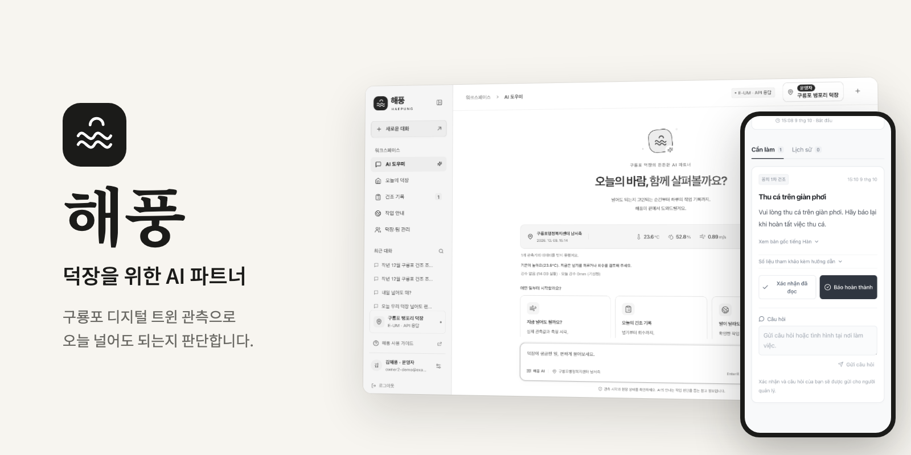
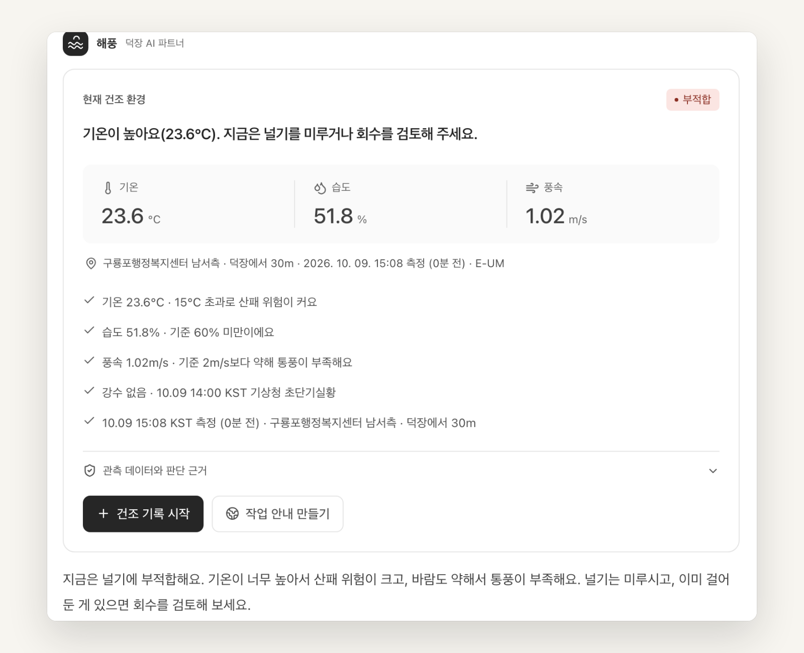
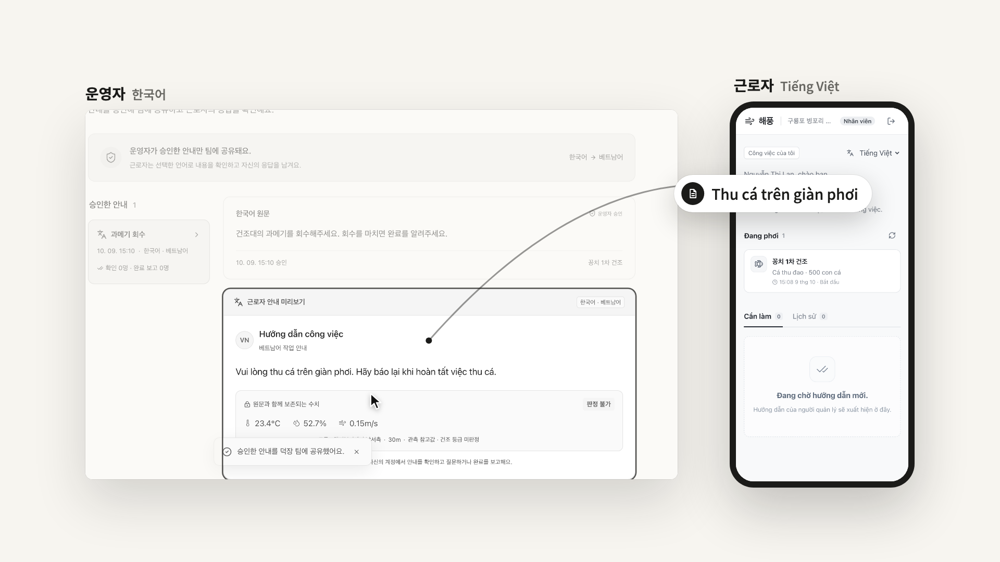
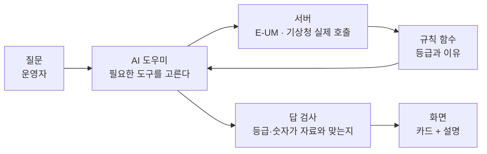
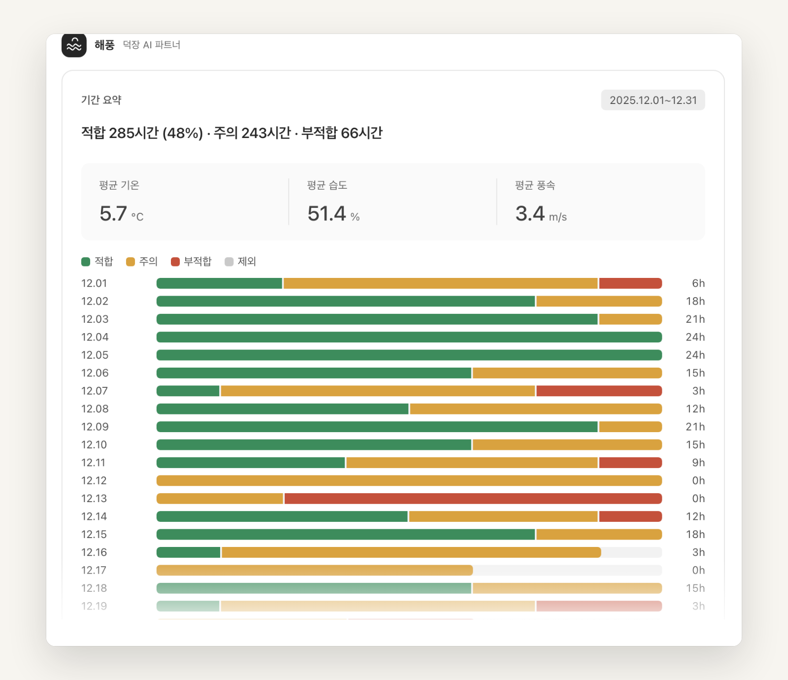

<div align="center">
  
  <h1>해풍</h1>
  <p><strong>구룡포 과메기 덕장을 위한 AI 파트너.<br>오늘 널어도 되는지, 덕장 옆 실제 관측으로 판단합니다.</strong></p>
  <p>
    <a href="#기능">기능</a> ·
    <a href="#어떻게-판단하나">어떻게 판단하나</a> ·
    <a href="#쓰는-데이터">쓰는 데이터</a> ·
    <a href="#시작하기">시작하기</a> ·
    <a href="#문서">문서</a>
  </p>
  <p><sub>2026 디지털 트윈 구룡포 AI 해커톤 출품작 · 팀 브레멘</sub></p>
</div>

해풍은 포항 구룡포의 과메기 덕장 운영자와 근로자가 함께 쓰는 웹앱입니다. 덕장 위치를 등록하면 1km 안의 E-UM 디지털 트윈 관측기를 찾아 지금의 기온·습도·풍속으로 널기 등급을 매기고, AI 도우미가 그 이유를 쉬운 말로 설명합니다. 건조 기록은 말 한마디로 시작해 30분마다 자동으로 쌓이고, 운영자가 승인한 작업 안내는 근로자의 언어로 휴대폰에 도착합니다.

<p align="center">
  
  <br>
  <em>"오늘 우리 덕장 널어도 괜찮아?" 등급은 규칙이 정하고, AI 는 근거와 함께 설명합니다. (2026-10-09 실제 관측)</em>
</p>

## 왜 만들었나

과메기는 겨울 바닷바람에 말립니다. 그런데 지금 덕장에서는

- **날씨 앱은 동네 단위 값만 알려 줍니다.** 덕장 바로 옆의 바람과 습도는 다를 수 있습니다.
- **널지 말지는 여전히 경험과 감에 맡깁니다.** 판단과 결과가 기록으로 남지 않아 다음 철에 돌아보기 어렵습니다.
- **외국인 근로자에게 작업과 그 이유를 정확히 전하기 어렵습니다.** 말이 다르면 확인도, 질문도 줄어듭니다.

해풍은 이 셋을 한 화면에서 풉니다. 판단은 실제 관측과 공개된 기준으로, 기록은 자동으로, 안내는 근로자의 언어로.

## 기능

- **지금 널어도 될까요?** 덕장에서 1km 안의 가장 가까운 최근 관측으로 적합·주의·부적합·판정 불가를 매깁니다. 관측 장비, 거리, 측정 시각, 적용한 기준을 함께 보여 주고, 믿을 만한 관측이 없으면 판정하지 않고 이유를 말합니다.
- **AI 도우미와 대화.** "내일 널어도 돼?", "작년 12월은 어땠어?"처럼 물으면 AI 가 이 덕장의 자료를 직접 조회해 답합니다. 숫자와 등급은 서버 코드가 계산하고 AI 는 설명만 합니다. 자료에 없는 숫자나 규칙과 다른 등급이 답에 섞이면 내보내기 전에 바꿉니다.
- **내일·모레 예보.** 기상청 단기예보에 같은 규칙을 적용해 날짜별 예상 등급 시간, 가장 긴 적합 구간, 강수확률을 보여 줍니다. 예보는 현재 판정을 바꾸지 않는 참고입니다.
- **지난 기간 분석과 비교.** 기상청 구룡포 AWS 의 과거 관측으로 기간별 적합 시간, 날짜별 등급 막대, 평균값을 보여 주고 두 기간을 견줍니다.
- **말하면 기록.** "방금 꽁치 500마리 널었어"라고 하면 건조 시작 확인 창이 채워진 채로 열립니다. 운영자가 승인해야 저장됩니다.
- **30분 자동 기록과 경보.** 진행 중인 배치에 30분마다 관측과 등급을 쌓고, 받지 못한 회차는 결측으로 남깁니다. 부적합이면 경보를 남깁니다. 배치마다 최소·최대·평균·결측을 요약하고 내려받을 수 있습니다.
- **근로자의 언어로 작업 안내.** 운영자가 한국어 원문을 승인하면 근로자 휴대폰에 베트남어로 보입니다. 근로자는 확인·질문·완료 보고를 남기고, 운영자는 질문에 답합니다. 질문과 답변은 쓴 원문 그대로 전달됩니다.
- **오늘의 덕장.** 운영자 홈에서 지금 관측, 진행 중인 건조, 답을 기다리는 근로자 질문을 한눈에 봅니다.
- **팀과 여러 덕장.** 7일 동안 한 사람만 쓸 수 있는 초대 링크로 근로자를 부릅니다. 역할은 덕장마다 정해지고, 여러 덕장을 오갈 수 있습니다.

<p align="center">
  
  <br>
  <em>운영자가 승인한 "과메기 회수" 안내가 근로자 휴대폰에 베트남어로 도착합니다.</em>
</p>

## 어떻게 판단하나



1. **관측을 고릅니다.** 등록한 덕장과 각 관측기 사이 거리를 재서 1km 안의 최근 E-UM 관측을 먼저 씁니다. E-UM 값이 비정상이거나 1km 안 기상청 구룡포 AWS 와 크게 다르면 그 장비를 건너뜁니다.
2. **규칙이 등급을 매깁니다.** AI 가 아니라 코드([`src/lib/drying.ts`](src/lib/drying.ts))가 정합니다.

   | 등급 | 조건 |
   | --- | --- |
   | 적합 | 습도 60% 미만, 풍속 2~14m/s, 기온 -5~10°C, 비·눈 없음 |
   | 주의 | 부적합은 아니지만 적합 조건을 하나라도 벗어남 (기상청 실황으로 비·눈을 확인하지 못한 때 포함) |
   | 부적합 | 비·눈, 풍속 14m/s 이상(기상청 강풍주의보 육상 기준), 습도 85% 이상, 기온 15°C 초과 |
   | 판정 불가 | 1km 안에 믿을 만한 최근 관측이 없거나 값이 비정상 |

   기준은 사업 기획서의 습도 60% 미만·풍속 2m/s 이상에 강풍·기온·강수를 더한 가설값(2026-10-06)입니다. 현장 검증 뒤 바꿀 수 있도록 판정마다 기준 버전을 함께 저장합니다 ([ADR 0010](docs/decisions/0010-drying-grade-rules.md)).
3. **AI 는 읽기만 합니다.** claude 는 이 덕장 범위의 읽기 전용 도구(현재 상태, 덕장 개요, 배치, 과거 기간, 기간 비교, 예보)만 받습니다. 화면 카드는 AI 가 실제로 부른 도구의 결과로만 붙습니다 ([ADR 0011](docs/decisions/0011-assistant-reads-with-tools.md)).
4. **답을 검사합니다.** 현재 등급과 다른 등급을 말하거나, 근거에 없는 측정 숫자를 쓴 답은 규칙 문장이나 도구 요약으로 바꿉니다. AI 가 응답하지 못해도 코드가 만든 요약으로 답합니다.

<p align="center">
  
  <br>
  <em>"작년 12월 구룡포 건조 조건 분석해줘" 기상청 구룡포 AWS 관측에 같은 규칙을 적용한 날짜별 등급입니다.</em>
</p>

## 쓰는 데이터

모두 실제로 호출합니다. 호출 기록과 응답 샘플은 [research/api-tests/](research/api-tests/)에 있습니다.

| 자료 | 제공 | 쓰는 곳 |
| --- | --- | --- |
| 대기환경 측정 장비 목록 `INT_S01_001`, 실시간 수집 정보 `INT_S01_003` | E-UM 디지털 트윈 포항 (구룡포읍) | 지금 판정, 30분 자동 기록 |
| 자외선 실시간 수집 정보 `INT_S06_005` | E-UM 디지털 트윈 포항 (구룡포읍) | 판단 근거의 자외선 |
| 초단기실황, 초단기예보 | 기상청 API허브 | 지금 비·눈, 앞으로 몇 시간 예상 등급 |
| 단기예보 | 기상청 API허브 | 내일·모레 예상 등급 |
| AWS 매분자료 (구룡포 816) | 기상청 API허브 | E-UM 대체·교차 확인, 강수량, 지난 기간 분석 |
| 출몰시각 | 한국천문연구원 (공공데이터포털) | 일출·일몰 |
| 주소 검색 | OpenStreetMap Nominatim | 덕장 등록 |

E-UM 이 정본이고 기상청은 보조입니다 ([ADR 0009](docs/decisions/0009-kma-fallback-for-eum.md)). E-UM 전체 API 는 [카탈로그](docs/api-catalog/README.md)에 정리했습니다.

## 시작하기

### 필요한 것

- **Node.js 22.18 이상**
- **E-UM 인증키** (`EUM_SERVICE_KEY`). [E-UM 디지털트윈 포항](https://pohang-eum.kr/data)에 로그인해 API 자료실에서 신청합니다.
- 선택: **기상청 API허브 키** (`KMA_AUTH_KEY`, 예보·강수·과거 분석), **공공데이터포털 키** (`DATA_GO_KR_KEY`, 일출·일몰)
- 선택: **AI 설명**. `LLM_PROVIDER=claude` 로 로그인한 claude CLI 를 쓰거나, OpenAI 호환 API 키(`OPENAI_API_KEY`)를 넣습니다. 없으면 코드가 만든 요약으로 답합니다.

### 실행

```bash
git clone https://github.com/BiQnT/gurong_agent26.git
cd gurong_agent26
npm install
cp .env.example .env.local   # 키 이름만 들어 있습니다. 값을 채웁니다 (커밋하지 않습니다)
npm run dev                  # http://127.0.0.1:3000
```

1. 이메일과 비밀번호로 가입하고, 덕장 이름·주소·지도 핀으로 덕장을 등록합니다.
2. **AI 도우미**에서 "오늘 우리 덕장 널어도 괜찮아?"라고 물어봅니다.
3. **덕장·팀 관리**에서 한국어 또는 베트남어 초대 링크를 만들어 근로자에게 전합니다.
4. **작업 안내**에서 안내를 승인하면 근로자 화면에 그 언어로 보입니다.

운영 서버는 `npm run build` 뒤 `npm start` 로 화면과 API 를 한 포트에서 제공합니다. `dist/` 만 정적 배포하면 API 가 빠집니다. VM 셋업·배포·백업은 [infra/gcp/README.md](infra/gcp/README.md)에 있습니다.

## 데이터와 개인정보

해풍에는 사용 분석·광고 추적 코드가 없습니다. 저장하는 것과 밖으로 나가는 것은 아래가 전부입니다.

### 저장하는 것

- **계정·덕장·작업:** 계정, 세션, 덕장, 초대, 배치, 안내와 응답을 서버의 SQLite 파일(`DATABASE_PATH`)에, 로컬 개발에서는 `.local-data/` 에 저장합니다.
- **비밀번호와 토큰:** 비밀번호는 scrypt 해시로, 초대·세션 토큰은 해시로 보관합니다. 브라우저에는 HttpOnly 세션 쿠키만 둡니다.
- **대화:** AI 도우미 대화는 사용자·덕장별로 브라우저 저장소에만 남습니다.

### 밖으로 나가는 것

- **AI 설명 (Anthropic 또는 설정한 OpenAI 호환 제공자):** 질문과 최근 대화(최대 12개), 그리고 AI 가 부른 도구의 결과(관측값, 덕장 이름·주소, 배치 요약, 팀원 수). 계정 이메일과 덕장·관측기 좌표는 보내지 않습니다.
- **기상청·공공데이터포털:** 덕장 좌표로 계산한 기상청 격자 번호, 일출·일몰 조회용 위경도.
- **E-UM:** 관측 장비 목록과 실시간 값 조회. 사용자 정보는 보내지 않습니다.
- **OpenStreetMap:** 덕장을 등록할 때 입력한 주소 검색어(Nominatim, 서버가 조회), 등록 화면의 지도 타일(브라우저가 받음).

이메일 확인, 비밀번호 재설정 메일, 문자 발송은 아직 없습니다. 근로자 초대 링크는 운영자가 직접 전합니다.

## 구조

React 화면과 Node 서버가 한 저장소에 있고, 운영 서버 하나가 화면과 API 를 함께 제공합니다.

```
src/              React 화면: 운영자 홈·건조 기록·작업 안내·팀 관리·AI 도우미, 근로자 할 일
  lib/drying.ts     널기 등급 규칙 (적합·주의·부적합·판정 불가)
  lib/analysis.ts   예보·기간 요약 계산
server/           Node 서버
  main.ts           운영 서버 (화면 + API)
  workspace.ts      인증·권한·초대·덕장 저장
  eum.ts            E-UM 관측과 거리 계산
  sources/          기상청 실황·예보·AWS, E-UM 자외선
  chat.ts           AI 도우미 (claude CLI 또는 OpenAI 호환)
  tool-server.ts    AI 가 쓰는 읽기 전용 도구 서버
  answer-checks.ts  AI 답 검사
  collect.ts        30분 자동 기록 (prod 타이머가 실행)
  prompts/          AI 도우미 지시문
docs/             결정 기록(ADR), 설계, E-UM API 카탈로그
research/         실제 API 호출 기록
infra/gcp/        VM 셋업·배포·백업
media/ir-intro/   발표용 소개 영상 (Remotion)
```

**기술:** React 18 · TypeScript · Vite · Node.js 22 · SQLite(better-sqlite3) · Leaflet · Framer Motion · claude CLI(읽기 전용 MCP 도구) · GCP VM + Caddy(HTTPS)

## 문서

| 문서 | 내용 |
| --- | --- |
| [PROJECT_SPEC.md](PROJECT_SPEC.md) | 범위: 실제 관측과 근거, 덕장별 배치 기록, 공유 안내와 근로자 응답 |
| [docs/decisions/](docs/decisions/) | 결정과 그 이유 (ADR) |
| [docs/design/backend.md](docs/design/backend.md) | 서버 구조: 저장, LLM 제공자, 접근 제어, 수집기 |
| [docs/design/chat-api.md](docs/design/chat-api.md) | 관측·채팅 API, AI 가 보는 도구, 답 검사 |
| [docs/design/workspace-api.md](docs/design/workspace-api.md) | 계정·덕장·작업 API |
| [docs/design/frontend.md](docs/design/frontend.md) | 화면 구조 |
| [docs/api-catalog/](docs/api-catalog/README.md) | E-UM Open API 카탈로그 |
| [research/api-tests/](research/api-tests/) | 실제 호출 기록과 응답 샘플 |
| [infra/gcp/README.md](infra/gcp/README.md) | VM 셋업·배포·비밀값·백업 |
| [CONTRIBUTING.md](CONTRIBUTING.md) | 팀 작업 방식: 브랜치, 문서 위치, 아이디어 관리 |

## 개발

```bash
npm test               # 단위 테스트
npm run build          # 타입 검사 + 화면 빌드
npm run format:check   # Prettier 검사
npm run collect        # 30분 자동 기록을 한 번 실행
```

브랜치, 커밋, 문서 규칙은 [CONTRIBUTING.md](CONTRIBUTING.md)를 따릅니다. 비밀키는 커밋하지 않고 `.env.example` 에 이름만 남깁니다.

<p align="center"><sub>오늘의 바람, 함께 살펴볼까요?</sub></p>
