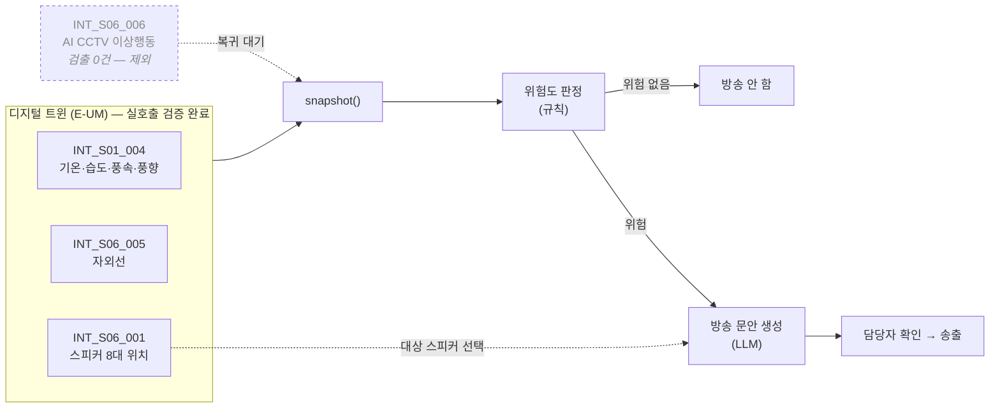

# 방파제 안내방송 에이전트

- **번호**: 001
- **제안자**:
- **작성일**: 2026-08-02
- **브랜치**: `idea/001-breakwater-broadcast`
- **상태**: 초안 (실호출 검증 완료 — 2026-08-03)

## 한 줄 요약

> 구룡포 방파제 관리자가, 기상 조건이 위험해진 순간, **남·북 방파제 스피커 8대에
> 바로 내보낼 수 있는 안내방송 문안**을 받는다.

> ⚠️ **원안에서 한 번 꺾였다.** 원래 트리거는 AI CCTV 이상행동 검출(`INT_S06_006`)이었는데
> 실호출해보니 10개월치 검출값이 전부 0이라 제외했다. 근거는 [data.md](data.md).
> 지금은 기상 실측(`INT_S01_004`)이 트리거다.

## 1. 해결하려는 문제

**닷새 전 구룡포에서 실제로 일어난 일.** 2026년 7월 28일 오후 1시 15분경 구룡포읍 장길리
[보릿돌교가 붕괴](https://www.mt.co.kr/society/2026/07/28/2026072815113938196)해
갯바위와 전망대에 있던 **어민·관광객 17명이 고립**됐다가 소방과 민간 어선에 구조됐다.
사망·부상은 없었고, 포항시는 전담반을 편성해
[해안 시설물을 전수 점검](https://www.seoul.co.kr/news/society/2026/07/29/20260729500072) 중이다.

이 사고가 근거인 이유는 **붕괴를 예측하겠다는 뜻이 아니다.** 사고 당시 구룡포 파고는
0.3m로 높지 않았고 원인은 기상이 아니라 구조물이었다. 이 에이전트는 그런 사고를 막지 못한다.

이 사고가 드러낸 건 다른 것이다 — **사고가 난 뒤에야 "17명이 있었다"는 걸 알았다.**
구룡포 해안 구조물에는 상시로 사람이 있는데, 지금 몇 명이 어디에 있고 위험한지를 아는
체계가 없다. 알았다 해도 그 사람들에게 말을 걸 방법이 없다.

전국 통계도 같은 방향을 가리킨다.

- 9년간 방파제 테트라포드 사고 **343건, 사망 46명** ([보도](https://v.daum.net/v/20260518063604530))
- 연안 안전 관련 민원 2022년 132건 → 2024년 **212건**, 연평균 27.6% 증가
  ([국민권익위](https://www.seoulfocus.kr/news/articleView.html?idxno=193961))
- 2024년 해양 안전사고 185건, 전체 인명피해 164명 중 **안전사고가 84명(51.2%)**
  ([해양수산부](https://www.mof.go.kr/doc/ko/selectDoc.do?docSeq=61012&bbsSeq=10&menuSeq=971))

구룡포는 방파제·갯바위가 관광 자원이자 조업 현장이라 이 위험에 상시 노출돼 있다.

## 2. 타깃 이용자

**구룡포읍사무소·포항시 안전 담당 공무원** — 방파제 스피커를 실제로 운용하는 주체.

관광객은 앱을 깔지 않는다. 어민은 이미 바다를 안다. **방송을 내보낼 권한과 장비를 가진
쪽**이 유일하게 실효 있는 사용자다. 포항시가 지금 해안 시설물 전담반을 돌리고 있어
행정 수요도 열려 있다.

## 3. 에이전트가 하는 일

**사용자 입력 예시**

```
지금 방파제 방송 내보내야 하나?
```

**에이전트 내부 동작**

1. `INT_S01_004` 로 기온·습도·풍속·풍향을, `INT_S06_005` 로 자외선 수치를 가져온다
2. **규칙으로** 위험도를 판정한다 (임계값은 실측 분포를 보고 정한다 — 9번 리스크 참고)
3. 위험하면 `INT_S06_001` 의 스피커 8대 중 해당 구역 장비를 고르고,
   **LLM이 그 상황·시간대·대상에 맞는 방송 문안을 생성**한다
4. 문안과 대상 스피커를 지도에 표시해 담당자가 확인 후 송출하도록 넘긴다

**출력 예시**

```
북방파제 SG-01-001 / SG-02-001 / SG-03-001 — 방송 권고

  풍속 8.4m/s · 풍향 275° (북서, 방파제 정면) · 기온 24.2℃ · 자외선 7.2(높음)

  [방송 문안]
  안내 말씀드립니다. 현재 북방파제 구간에 강한 바람이 불고 있습니다.
  테트라포드 위는 미끄러워 매우 위험하오니 즉시 내려와 주시기 바랍니다.
  Attention. Strong winds at the north breakwater. Please step away
  from the tetrapods immediately.

  근거: INT_S01_004 (2026-08-02 15:05 측정, 풍속 8.4 · 풍향 275.1)
```

**판단·추천·경보·시각화 중 무엇인가**: 경보(방송 권고) + 판단(위험도) + 시각화(대상 스피커 지도).

## 4. 쓰는 데이터

**전부 실호출로 검증했다.** 요청·응답 원문과 판정 근거는 [data.md](data.md).

| API ID | 기능 | 판정 | 이 아이디어에서 쓰는 이유 |
| --- | --- | --- | --- |
| `INT_S06_001` | 보행자안전 장비 목록 | ✅ **스피커 8대·AI CCTV 15대·자외선 1대 확인** | 방송 대상 선택과 지도 시각화의 근거 |
| `INT_S01_004` | 대기환경 실시간 | ✅ 기온·습도·풍속·풍향 실시간 | 위험도 판정의 트리거 |
| `INT_S06_005` | 자외선 실시간 | ✅ 실시간 갱신 확인 | 여름철 체류 위험. 보조 지표 |
| `INT_S06_006` | 이상행동 발생수 | ❌ **10개월치 검출 0건** | 원래 트리거였으나 제외. 주최 측 문의 중 |
| `INT_S03_019` | 주요 기상 요소 과거 | ⚠️ 날짜별 구멍 | `INT_S01_004`로 대체 |

## 5. 차별성

- **안전디딤돌·재난문자** — 이미 벌어진 뒤에, 행정구역 단위로 나간다.
  여기는 **스피커 한 대 단위**로, 그 구역에 있는 사람에게 나간다
- **기존 방파제 스피커** — 녹음된 고정 멘트를 튼다. 여기는 상황·시간대·대상에 맞춰
  매번 다른 문안을 만든다. 새벽 조업 어민과 주말 낮 가족 관광객에게 할 말이 다르고,
  외국인이 섞이면 언어가 달라진다
- **포털 날씨** — 수치를 보여준다. 여기는 "그래서 방송을 내보내라 / 말라"까지 간다

**"AI를 쓴다"는 차별성이 아니다.** 이 아이디어의 차별점은 **경보 자체가 아니라 문안 생성**에
있다. 주최 측 제시 예시("방파제 보행자/기상 데이터로 위험 접근을 경보하는 안전 안내
에이전트")와 소재가 겹치므로, 기획서에서 이 구분을 앞세워야 한다.

## 6. 구현 범위

본선 개발 기간은 **2026-09-07 ~ 09-28 (3주)** 뿐이다.

**꼭 만드는 것 (MVP)**

- [x] E-UM API 4개 래퍼 — 데이터 레이어 (`prototype/eum_client.py`). *실호출 검증은 아직*
- [ ] 규칙 기반 위험도 판정 (임계값은 실호출 분포를 보고 확정)
- [ ] LLM 방송 문안 생성 (한국어 + 영어)
- [ ] 스피커·CCTV 위치 지도와 대상 구역 표시

**되면 좋은 것**

- [ ] 과거 데이터 재생으로 "7월 28일 그날이라면" 시뮬레이션
- [ ] 다국어 확장 (중국어·일본어)

**안 만드는 것**

- **실제 스피커 송출** — 장비 제어 권한이 없다. 문안 생성까지가 범위다
- **영상 분석** — `INT_S06_006` 이 이미 검출 결과를 준다
- **구조물 안전 진단** — 보릿돌교 같은 붕괴는 이 에이전트가 다루는 문제가 아니다

## 7. 아키텍처



**위험 판단은 규칙, 문안 생성만 LLM.** 경보 여부를 LLM이 정하면 환각이 안전 판단에
끼어들고, "왜 그 시점에 경보가 나갔는지" 설명할 수 없게 된다.
자세한 근거는 [decisions/0001-scope.md](decisions/0001-scope.md).

## 8. 기대효과 · 지역 사회 기여

포항시는 보릿돌교 붕괴 이후 **전담반을 편성해 해안 시설물을 점검 중**이다. 행정 수요가
지금 열려 있고, 이 서비스는 그 흐름에 바로 붙는다.

- **구룡포읍사무소 안전 담당** — 방파제 스피커 운용의 판단 근거. 지금은 담당자 재량이다
- **포항시 해양수산과 / 안전정책과** — 이상행동 발생 지점·시간대가 쌓이면 어디에 난간·
  안내판·추가 CCTV가 필요한지 예산 근거가 된다
- **포항해양경찰서** — 사고 발생 시 "그 구역에 몇 명이 있었나"에 답할 수 있다

## 9. 리스크

**해소됨** — 실호출로 확인한 것

| 원래 리스크 | 결과 |
| --- | --- |
| "이상행동"의 정의가 카탈로그에 없다 | **해소.** 필드명이 추락·구역 진입·접근이다. 방파제 안전에 정확히 맞는다 |
| 스피커·AI CCTV가 몇 대인지 모른다 | **해소.** 스피커 8대(남북 각 4), AI CCTV 15대. 구역별 방송이 성립한다 |

**남아 있음**

| 리스크 | 영향 | 대응 |
| --- | --- | --- |
| **`INT_S06_006` 검출값이 10개월치 전부 0** | 원래 트리거를 잃었다. "지금 방파제에 사람이 있는가"를 알 수 없어 방송 필요성의 근거가 약해진다 | 주최 측(권소현)에 가동 여부·일정 문의. 9월 개발 기간에 켜지면 트리거 복귀. **답 오기 전까지 의존하지 않는다** |
| 위험도 임계값의 근거가 없다 | 심사에서 "왜 그 숫자인가"에 못 답함 | **숫자를 지어내지 않는다.** `INT_S01_004` 풍속 분포를 며칠 수집해 정하고 근거를 data.md에 남긴다 |
| 자외선 측정기가 1대이고 위치가 병포리(내륙)다 | 방파제 실측이 아니다 | 단일 값을 전 구역에 적용하고 한계를 명시. 보조 지표로만 쓴다 |
| 스피커 `SG-10-001`의 위경도가 빈 문자열 | 8대 중 1대를 지도에 못 찍는다 | 주소도 비어 있어 보정 불가. 7대로 진행하고 결손을 명시 |
| 주최 측 제시 예시와 소재가 겹친다 | 차별성 감점 | 경보가 아니라 **문안 생성**을 앞세운다 |
| 파고·조위가 E-UM 전체에 없다 | 월파 위험을 직접 못 봄 | 풍속으로 대리. 필요하면 기상청 해양기상부이로 보충 |

## 10. 자체 점수 (심사 기준 그대로)

> **실호출 전이라 아직 매기지 않는다.** `research/api-tests/probe_eum_apis.py` 를 돌려
> `INT_S06_*` 의 판정과 장비 대수를 확인한 뒤 채운다. 지금 매기면 근거 없는 숫자가 된다.

| 항목 | 배점 | 자체 점수 | 근거 |
| --- | --- | --- | --- |
| 구체성 및 논리성 | 30 | | |
| 주제 적합성 | 25 | | |
| 실현 가능성 | 25 | | |
| 지역 사회 기여도 | 20 | | |
| **합계** | **100** | | |
