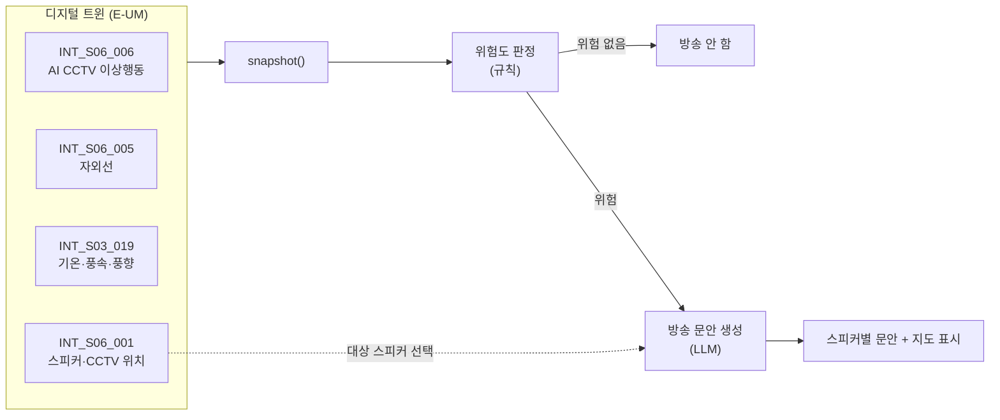

# 프로토타입 — 방파제 안내방송 에이전트

## 돌려보기

서비스키는 **레포 루트의 `.env`** 하나가 정본이다. 이 폴더에 `.env` 를 만들지 않는다.

```bash
# 레포 루트에서 한 번만
cp .env.example .env      # EUM_SERVICE_KEY 채우기

# 상황 스냅샷 — 장비 목록 + 자외선 + 기상 + 이상행동
python3 ideas/001-breakwater-broadcast/prototype/eum_client.py
```

의존성 없다. 파이썬 표준 라이브러리만 쓴다.

## 구성

| 파일 | 역할 |
| --- | --- |
| `eum_client.py` | E-UM API 4개 래퍼 + `snapshot()` — 데이터 레이어 |
| `.env.example` | 이 아이디어가 추가로 필요한 키 이름 (현재 없음) |

## 파이프라인



**위험 판단은 규칙, 문안 생성만 LLM**이다. 이 경계가 이 아이디어의 핵심이다 —
경보를 낼지 말지를 LLM이 정하면 환각이 안전 판단에 끼어들고, 심사에서도
"왜 그 시점에 경보가 나갔는지" 설명할 수 없게 된다.

문안 생성이 LLM 인 이유는 같은 위험도라도 할 말이 달라지기 때문이다.
평일 새벽의 조업 어민과 주말 낮의 가족 관광객, 외국인이 섞인 상황에서
방송 내용·어조·언어가 전부 달라진다. 이건 규칙으로 못 만든다.

## 아직 안 만든 것

- **위험도 판정 규칙** — 임계값을 실제 응답 분포를 보고 정한다.
  `research/api-tests/probe-summary.md` 가 나오기 전에 숫자를 지어내지 않는다.
  ([0001-scope.md](../decisions/0001-scope.md) '아직 안 정한 것' 참고)
- **문안 생성 (LLM 호출)** — 위 규칙이 정해진 뒤에 붙인다.
- **지도 시각화** — 장비 좌표는 `INT_S06_001` 한 번으로 다 나온다.
  `data/eum-devices.geojson` 에 전 서비스 장비가 합쳐져 있다.

MVP 범위는 **방송 문안 생성까지**다. 실제 스피커 송출은 하지 않는다 —
장비 제어 권한이 없고, 있더라도 대회 범위 밖이다.
