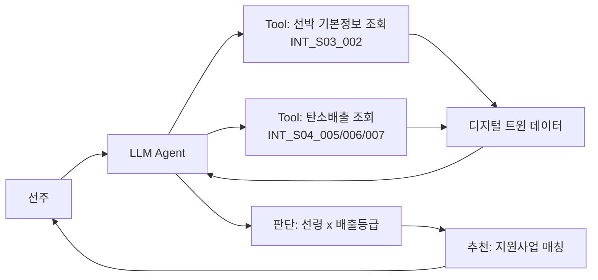

# 탄소중립 인센티브 트래커

- **번호**: 001
- **제안자**:
- **작성일**: 2026-08-06
- **브랜치**: `idea/001-carbon-incentive`
- **상태**: 초안

## 한 줄 요약

> 구룡포 어선 선주가 자기 배 선박번호를 물으면, 탄소배출 수준과 선령을 판단해 해당하는 정부 지원사업(노후어선 대체건조사업 / 친환경인증선박 보급지원사업)을 추천해주는 대화형 에이전트.

## 1. 해결하려는 문제

해양수산부는 어촌·수산 부문 탄소중립을 위해 노후어선 대체건조사업(근해어선 대상, 사업비 약 568억원)과
친환경인증선박 보급지원사업(2026-07-26 공고, 건조비 최대 30%·척당 35억 한도 지원)을 운영 중이다.
하지만 개별 선주 입장에서 "내 배가 어떤 사업 대상인지"를 스스로 계산할 방법이 없다 — 공고문은
기관·사업별로 흩어져 있고, 내 배의 탄소배출이 동급 대비 얼마나 되는지 확인할 수단이 없다.

구룡포는 어업인 60세 이상 비중이 70%를 넘는 지역이라(`ideas/brainstorming.md` #2 참고),
이런 행정정보 접근성 문제가 특히 크다.

## 2. 타깃 이용자

구룡포항 소속 어선 선주 (특히 고령 어업인)

## 3. 에이전트가 하는 일

필수 요건 3가지를 여기서 증명한다. 대화 예시를 하나 이상 구체적으로 쓴다.

**사용자 입력 예시**
```
0003005-6491102 배 탄소 배출 어때?
```

**에이전트 내부 동작**
1. `INT_S03_002`로 선박 기본정보(톤수 `gt`, 진수일자 `launchingYmd`) 조회 → 선령 계산
2. `INT_S04_006`으로 해당 `shipId`의 최근 탄소배출량(`recentEmi`)과 범례 등급(`level`) 조회
3. `INT_S04_005`로 동급 톤수 그룹(`shipType`)의 당일 평균 배출량(`avgPerEmis`)과 비교
4. `INT_S04_007`로 탄소중립 상위 5척 리스트(`top5ContributionShips`/`top5CarbonNeuturalShips`)에
   근접한지 확인
5. 판단: (선령 + 배출 등급 + 동급 평균 대비 위치)를 조합해 "노후·고배출" / "탄소중립 우수" / "평균권" 중
   하나로 분류하고, 해당하는 지원사업을 추천

**출력 예시**
```
[선박 0003005-6491102 · 제33안성호]
톤수: 43t (소형 S1)   선령: 26년 (2000-03-01 진수)
최근 탄소배출 등급: 4/5 (동급 톤수 평균보다 높음)

판단: 노후·고배출 선박으로 분류됩니다.
추천: 노후어선 대체건조사업 신청을 검토해보세요.
      (해양수산부·근해어선 대상, 사업비 약 568억원 규모)
※ 정확한 자격 요건은 신청 전 관할 기관(수협/해양수산부)에 재확인이 필요합니다.
```

> 판단(선령+배출등급 분류) + 추천(지원사업 매칭)을 수행한다. 단순 질의응답이 아니다.

## 4. 쓰는 데이터

API ID까지 특정한다. 상세는 [data.md](data.md)에.

| API ID | 기능 | 이 아이디어에서 쓰는 이유 |
| --- | --- | --- |
| `INT_S03_002` | 구룡포항_선박 기본정보_단일 | 선박 톤수, 진수일자(선령 계산) 확인 |
| `INT_S04_005` | 선박 톤수별 당일 탄소 배출량 | 동급 톤수 그룹 평균과 내 배 비교 |
| `INT_S04_006` | 선박 시간별 탄소 배출량 | 개별 선박(`shipId`)의 배출량·등급 조회 — top5 밖의 임의 선박도 조회 가능한 핵심 API |
| `INT_S04_007` | 선박 톤수별 탄소 배출 및 중립 순위 정보 | 탄소중립 상위권(top5) 근접 여부 확인 |

정부 지원사업(노후어선 대체건조사업, 친환경인증선박 보급지원사업) 정보는 E-UM 디지털트윈 API가
아니라 해양수산부 공고 등 정적 참고자료다. 핵심 판단(선령·배출등급·순위 비교)은 위 4개 API의
실제 호출 결과로 이뤄지고, 지원사업 매칭은 그 판단 결과에 얹는 추천 레이어로 명확히 구분한다.

## 5. 차별성

해수부·수협 공고문은 사업별로 흩어져 있고, "내 배가 해당되는지"를 계산해주지 않는다. 이 에이전트는
실제 탄소배출 데이터를 근거로 자동으로 매칭해서 알려준다는 점이 다르다. "AI를 쓴다"가 아니라
"공고문을 뒤지지 않아도 내 배 기준으로 결과가 나온다"는 것이 차별점이다.

## 6. 구현 범위

본선 개발 기간은 **2026-09-07 ~ 09-28 (3주)** 뿐이다.

**꼭 만드는 것 (MVP)**
- [ ] `INT_S03_002`, `INT_S04_005/006/007` 실제 호출해서 응답 확인 (`data.md`에 기록)
- [ ] `level` 등급 방향성(1이 저배출인지 고배출인지) 확인
- [ ] 선령+배출등급 판단 매트릭스 구현
- [ ] 대화형 챗봇 UI (shipId 조회형)
- [ ] 노후어선 대체건조사업 / 친환경인증선박 보급지원사업 정적 정보 카드 연결

**되면 좋은 것**
- [ ] 동급 톤수 평균 대비 텍스트 막대 시각화
- [ ] 최근 배출 추이(시간별) 그래프

**안 만드는 것** — 범위를 미리 잘라두면 심사에서 오히려 유리하다
- 지원사업 실제 신청·제출 기능 (안내까지만)
- 선박 소유 인증 체계 (로그인 없이 shipId 직접 조회로 데모)
- 정기 알림(push) 기능 — 조회형(pull)으로 한정

## 7. 아키텍처



## 8. 기대효과 · 지역 사회 기여

포항시 수산과·구룡포수협이 노후어선 대체건조사업 등 지원사업 홍보·안내 창구로 활용할 수 있다.
행정정보 접근성이 낮은 고령 어업인이 공고문을 직접 찾지 않아도 자기 배 기준으로 해당 사업을
바로 안내받을 수 있다.

## 9. 리스크

| 리스크 | 영향 | 대응 |
| --- | --- | --- |
| `level` 등급 방향(1=저배출 vs 1=고배출)이 카탈로그 문서에 명시 안 됨 | 판단 로직이 반대로 설계될 위험 | 구현 착수 즉시 실제 API 호출로 값 검증 (`data.md`에 기록) |
| top5 밖 선박은 명시적 순위가 없음 | "순위"를 부정확하게 언급할 위험 | 순위는 top5 근접 여부만 사용, 핵심 판단은 `level` 등급과 동급 평균 비교로 한정 |
| 지원사업 자격요건을 팀이 실제로 검증하지 않음 | 선주에게 잘못된 기대를 줄 수 있음 | "정확한 조건은 관할 기관에 재확인 필요" 문구를 출력에 항상 포함 |
| `INT_S04_*` API가 실시간이 아니라 일 단위 통계 | "에이전트"보다 "정적 리포트"처럼 보일 위험 | 대화형 인터페이스 + 판단/추천 문구로 상호작용성 보강 |
| 친환경인증선박 보급지원사업은 대형 연안선사 위주라 구룡포 소형 어선과 규모 불일치 가능 | 추천이 부정확할 수 있음 | 두 사업의 대상 규모 차이를 출력에 명시, 노후어선 대체건조사업을 주 추천으로 우선 |

## 10. 자체 점수 (심사 기준 그대로)

API 실제 호출 검증 전이라 잠정치다. `data.md` 검증 후 재산정 필요.

| 항목 | 배점 | 자체 점수 | 근거 |
| --- | --- | --- | --- |
| 구체성 및 논리성 | 30 | 20 | 문제·데이터·판단 로직은 구체적이나, 지원사업 자격요건 미검증 상태 |
| 주제 적합성 | 25 | 18 | 환경(탄소)·경제(어업) 문제 해결형이나 "환경·안전·관광" 중 관광과는 무관 |
| 실현 가능성 | 25 | 12 | `INT_S04_*` API 실제 호출·`level` 방향성 미검증 — 최우선 리스크 |
| 지역 사회 기여도 | 20 | 14 | 고령 어업인 행정접근성 개선, 포항시 수산과 활용 경로 명확 |
| **합계** | **100** | **64** | |
