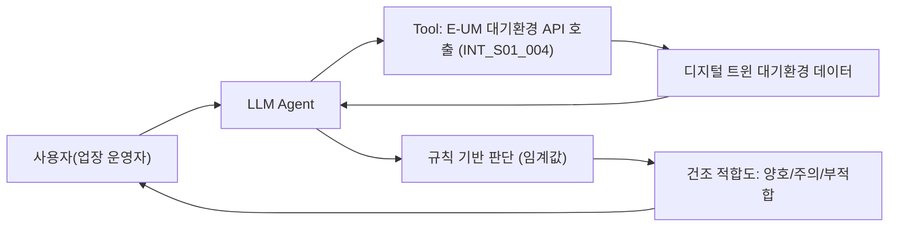

# 구룡포 과메기 통합 에이전트

- **번호**: 001
- **제안자**: 김영재
- **작성일**: 2026-08-04
- **브랜치**: `idea/001-gwamegi-integrated-agent`
- **상태**: 초안

## 한 줄 요약

> 과메기 가공업체 운영자가 건조 작업 전에 / 대기환경 데이터를 기반으로 지금 건조 조건이 괜찮은지 확인하고, 나아가 업장별 건조 실태를 데이터로 파악한다.

## 1. 해결하려는 문제

- 구룡포는 전국 과메기 생산량의 80% 이상을 차지하며, 과메기 산업만으로 연평균 600억원 이상의 경제 효과를 냄
- 과메기 산업특구 내 가공업체 180곳, 약 1,500명이 종사 — 지역 경제의 핵심 산업
- 건조 방식(전통 자연건조 vs 실내 인공건조)에 따라 산패도가 크게 달라지지만, 이를 판단할 공통 기준이 없음
  - 자연건조는 산패가 심한 편이지만 중노년층 소비자 선호로 유지되는 업장이 많음
  - 일부 업장은 미세먼지 등을 이유로 실내 인공건조로 전환
  - 업장마다 건조 방식이 다르고 외부에서 이를 확인할 방법이 없어 품질에 대한 우려가 존재

## 2. 타깃 이용자

**과메기 가공업체 운영자(상인)**를 1차 타깃으로 특정한다. (소비자·포항시·과메기협동조합은 익명 집계 데이터의 2차 활용자로, MVP 이후 확장 대상)

## 3. 에이전트가 하는 일

> **MVP 범위 안내**: 아래는 최종 지향점이며, MVP(3주 개발 범위)에서는 **야외 건조장 시나리오 하나**만, **대기환경 API 1개**와 **규칙 기반 간이 판단**으로 구현한다. 정교한 "산패 위험 지수" 계산과 실내 건조장 시나리오, 익명 데이터 집계는 MVP 이후 범위다 (6번 항목 참고).

**사용자 입력 예시 (MVP 대상)**
```
오늘 오후에 과메기를 널어도 괜찮을까?
```

**에이전트 내부 동작 (MVP)**
1. `INT_S01_004`(대기환경 실시간 단일)를 호출해 현재 온도·습도·풍속·미세먼지(PM10/PM2.5) 값을 가져온다
2. 각 항목에 임계값을 두고 규칙 기반으로 "양호 / 주의 / 부적합" 3단계를 판단한다 (예: 습도 80% 초과 또는 풍속 1m/s 미만이면 "주의", PM10 150 초과면 "부적합")
3. 판단 결과와 근거 수치를 자연어 문장으로 조합해 응답한다

**출력 예시**
```
현재 기온 8℃, 습도 62%, 풍속 3.2m/s로 건조 조건은 양호합니다.
미세먼지(PM10)는 보통 수준입니다.
```

> 단순 질의응답이 아니라 임계값 기반 **판단**을 내리므로 필수 요건 3(판단·추천·경보·시각화)을 충족한다.

**MVP 이후 지향점 (참고용, 이번 폴더의 구현 대상 아님)**
- 실내 건조장: 사용자가 입력한 온습도·건조 시간에 외기 데이터를 더해 판단
- 자외선(UV) 데이터를 더해 "OO시~OO시 직사광선 노출 주의" 같은 시간대별 경보
- 업장별 세척·건조 조건을 익명 집계해 포항시/과메기협동조합이 실태 데이터로 활용

## 4. 쓰는 데이터

MVP에서 실제로 호출하는 API는 1개, 선택적으로 1개를 추가한다. 상세 호출 기록은 [data.md](data.md)에.

| API ID | 기능 | 이 아이디어에서 쓰는 이유 |
| --- | --- | --- |
| `INT_S01_004` | 대기환경 측정 장비 실시간 수집 정보_단일 | 온도·습도·풍속·풍향·PM10/PM2.5를 한 번의 호출로 받아 건조 조건 판단의 핵심 입력으로 사용 (MVP 필수) |
| `INT_S06_005` | 자외선 측정 장비 실시간 수집 정보 | 야외 건조 시 자외선에 의한 지질 산화 위험 경고에 사용 (MVP 선택, 여유 있으면 추가) |

과메기 철이 아니라 실시간 값의 데모 임팩트가 약할 수 있어, 필요하면 `INT_S01_011`/`INT_S01_012`(대기환경 통계 API)로 과거 데이터를 함께 보여주는 것을 검토한다.

## 5. 차별성

- 포털 날씨 앱 → 날씨 수치만 보여줄 뿐, 과메기 건조라는 특정 용도의 적합/부적합 판단은 하지 않음
- 미세먼지 앱 → 야외활동 기준 경보이지, 식품 건조 관점의 위험 판단이 아님
- 기존 스마트팜 관리 시스템 → 개별 업장 하나에만 적용되는 폐쇄형 시스템. 이 에이전트는 (향후) 실내/야외를 아우르고, 개별 업장을 넘어 시/협동조합 차원의 실태 파악까지 지향

## 6. 구현 범위

본선 개발 기간은 **2026-09-07 ~ 09-28 (3주)** 뿐이다. MVP는 범위를 최대한 좁혀 "실제로 동작하는 것"을 우선한다.

**꼭 만드는 것 (MVP)**
- [ ] `INT_S01_004` 실제 호출 스크립트 (`prototype/`)
- [ ] 온도·습도·풍속·PM10 임계값 기반 "양호/주의/부적합" 판단 로직
- [ ] 판단 결과를 자연어 문장으로 응답하는 최소 대화 인터페이스 (CLI 또는 간단한 스크립트 입출력)
- [ ] 야외 건조장 시나리오 1개

**되면 좋은 것**
- [ ] `INT_S06_005` 자외선 데이터 추가해 시간대별 경고 문구 강화
- [ ] `INT_S01_011`/`012` 통계 API로 과거 데이터 기반 데모 (과메기 비수기 대응)
- [ ] 실내 건조장 시나리오 (사용자 입력값 + 외기 데이터)
- [ ] 산패 위험을 수치화한 "지수" 형태로 고도화 (선행 연구 조사 필요)

**안 만드는 것** — 범위를 미리 잘라두면 심사에서 오히려 유리하다
- 업장별 데이터를 저장·집계하는 익명화 인프라 (개인정보/영업비밀 보안 설계가 필요해 3주 내 검증 어려움)
- 과학적으로 검증된 산패 예측 모델 (선행 연구·실측 검증 없이 만들면 근거 없는 수치가 됨)
- 과메기 외 다른 수산물/지역으로의 확장

## 7. 아키텍처



## 8. 기대효과 · 지역 사회 기여

- 과메기 가공업체 운영자가 건조 시점 판단을 감(경험)이 아닌 데이터 근거로 보완할 수 있음
- MVP 이후 익명 집계 데이터가 쌓이면, 포항시 수산유통 관련 부서나 구룡포 과메기협동조합이 업장별 건조 방식 실태를 파악해 위생/품질 관련 지침을 마련하는 데 참고 자료로 활용 가능
- 자연건조 대비 인공건조의 실제 조건 차이를 데이터로 축적하면, 소비자 신뢰도 제고를 위한 표시제 등 후속 정책 논의의 근거가 될 수 있음

## 9. 리스크

| 리스크 | 영향 | 대응 |
| --- | --- | --- |
| 지금이 과메기 건조 철이 아님 | 실시간 데이터로는 "건조 중" 상황을 실감나게 데모하기 어려움 | 통계 API(`INT_S01_011`/`012`)로 과거 시즌 데이터를 함께 보여주는 방식 검토 |
| 산패 위험을 정량화할 과학적 기준이 없음 | 근거 없는 수치를 제시하면 신뢰도·심사 논리성에서 감점 | MVP는 "지수" 대신 임계값 기반 간이 판단으로 범위를 좁히고, 고도화는 이후 과제로 명시 |
| 대기환경 측정 장비와 실제 업장 간 물리적 거리 | 측정값이 특정 업장의 실제 국지 조건과 다를 수 있음 | 장비 위경도를 확인해 커버 범위 안의 업장을 대상으로 한정, 한계로 명시 |
| 업장 데이터 유출 시 영업비밀과 상충 | 업장이 데이터 제공(익명 집계)을 꺼릴 수 있음 | MVP는 업장 입력 데이터를 아예 받지 않아 해당 없음. 익명 집계 기능은 보안 설계 후 후속 단계에서 도입 |
| 실제 운영 중인 실내/야외 업장 수가 불명확 | 수요 검증이 약할 수 있음 | 과메기협동조합/포항시에 업장 현황 문의 필요 |
| 주제가 환경/안전/관광 중 하나로 명확히 나뉘지 않음 | 심사 카테고리 프레이밍이 애매할 수 있음 | 대기질 기반 판단이라는 점에서 "환경" 축으로 프레이밍하고 지역 산업 연계를 부가 설명 |

## 10. 자체 점수 (심사 기준 그대로)

솔직하게 매긴다. 낮게 나오는 항목이 이 아이디어의 약점이다.

| 항목 | 배점 | 자체 점수 | 근거 |
| --- | --- | --- | --- |
| 구체성 및 논리성 | 30 | | |
| 주제 적합성 | 25 | | |
| 실현 가능성 | 25 | | |
| 지역 사회 기여도 | 20 | | |
| **합계** | **100** | | |
