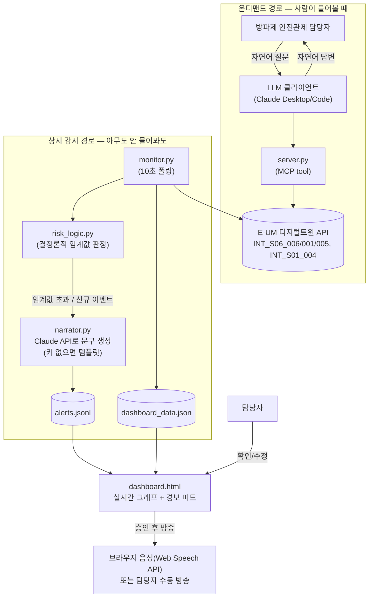

# 구룡포 방파제 보행자 안전 경보 에이전트

- **번호**: 002
- **제안자**: junnnnnw00
- **작성일**: 2026-08-06
- **브랜치**: `idea/002-breakwater-guard`
- **상태**: 초안

## 한 줄 요약

> 구룡포 방파제 안전관제 담당자가 순찰·방송 여부를 판단해야 하는 순간에, AI CCTV 이상행동 통계와 자외선·기상 데이터를 종합해 지금 위험도가 어느 수준인지 판단하고 어느 스피커로 어떤 경보를 내보낼지 추천한다.

## 1. 해결하려는 문제

- 구룡포 방파제(북방파제·남방파제)는 낚시·산책객이 몰리는 관광 명소이면서, 테트라포드 실족·전복 등 인명사고가 반복되는 위험 구역이다. 해양경찰청·포항시가 매년 여름·가을 성수기에 방파제 낚시객 안전사고 예방 캠페인을 벌이는 이유이기도 하다.
- E-UM 디지털트윈은 방파제에 AI CCTV·스피커·자외선 측정기를 이미 설치해 실족감지·침입감지·접근경고·보행자 이상감지 이벤트를 시간대별로 수집하고 있지만(`INT_S06_006`), 이 통계를 담당자가 실시간으로 해석해서 "지금 방송을 내보내야 하는가, 어느 스피커로 내보내야 하는가"까지 판단해주는 장치는 없다 — CCTV 화면과 숫자만 있고 판단은 사람 몫이다.
- 담당 인력은 소수인데 감시 대상 구역(남/북 방파제, 여러 스피커·CCTV 지점)은 여러 곳으로 나뉘어 있어, 이상행동이 몰리는 시간대·구역을 놓치기 쉽다.

## 2. 타깃 이용자

**공무원(포항시 구룡포 방파제 안전관제 담당자)**을 1차 타깃으로 특정한다. (관광객·낚시객은 스피커 방송을 통해 혜택을 받는 간접 수혜자로, MVP 이후 "관광객이 직접 물어보는 안전 챗봇" 형태로 확장 가능)

## 3. 에이전트가 하는 일

> **초안에서 방향이 바뀐 점**: 처음엔 "사람이 물어보면 답하는" MCP tool 하나만 계획했는데,
> 안전 경보가 질의응답식이면 안 된다는 피드백에 따라 **두 경로**로 나눴다. 아래 "두 경로" 참고.

### 두 경로: 물어보면 답하는 것 vs 알아서 알리는 것

| | 온디맨드 질의 (`prototype/server.py`) | 상시 감시·경보 (`prototype/monitor.py` + `dashboard.html`) |
| --- | --- | --- |
| 언제 동작하나 | 사람이 채팅으로 물어봤을 때만 | 폴링 주기(기본 10초)마다 항상 |
| 인터페이스 | MCP tool → Claude Desktop/Code 같은 LLM 클라이언트 | 웹 대시보드 (실시간 그래프 + 경보 피드) |
| 트리거 | 사람의 자연어 질문 | 임계값 초과·신규 이상행동 발생 (자동 감지) |
| 필수 요건 1 (자연어) 충족 방식 | LLM 클라이언트가 tool 결과로 직접 답함 | 대시보드가 사람이 읽을 문장(요약+방송문구)을 자동 생성해서 보여줌 |

**사용자 입력 예시 (온디맨드 경로)**
```
지금 방파제 상황 어때? 방송 내보내야 돼?
```

**에이전트 내부 동작 (공통 판정 로직, `risk_logic.py`)**
1. `INT_S06_006`(시간대별 이상행동 발생수 통계)를 호출해 남/북 방파제별 실족감지·침입감지·접근경고·보행자 이상감지 건수를 가져온다
2. `INT_S06_005`(자외선 실시간)와 `INT_S01_004`(대기환경 실시간 — 풍속·기온)를 호출해 위험을 높이는 외부 조건(강풍, 폭염, 강한 자외선)을 함께 본다
3. 구역별로 이상행동 건수 합계에 임계값을 두고 "양호 / 주의 / 위험" 3단계로 판정하고, 위험도가 가장 높은 구역과 그 구역에 설치된 스피커 장비(`INT_S06_001`의 `speakers` 목록)를 매칭해 방송 대상을 추천한다

**출력 예시 (온디맨드)**
```
북방파제: 최근 1시간 접근경고 12건, 실족감지 2건 — 위험
남방파제: 접근경고 3건 — 양호
현재 풍속 8.1m/s로 강풍주의보 수준, 테트라포드 위 보행 위험이 큽니다.
북방파제 스피커(SR-01-001)로 안전방송을 우선 송출하는 것을 권장합니다.
```

**상시 감시 경로 동작 (`monitor.py`)**: 이전 폴링 대비 실족감지·접근경고 등이 **새로 늘어나면**,
또는 구역 위험도가 "위험"으로 올라가면, 또는 풍속·자외선·기온이 임계값을 넘으면 즉시 경보 이벤트를
만든다. 대시보드는 이 경보를 실시간 피드로 보여주고, "위험" 등급은 브라우저 음성(Web Speech API)으로
자동 안내한다.

> 단순 질의응답이 아니라 구역별 이상행동 통계 + 기상 조건을 종합해 위험도를 **판단**하고, 방송 장비를
> **추천**하고, 임계값 초과 시 **경보**하고, 실시간 그래프로 **시각화**하므로 필수 요건 3(판단·추천·
> 경보·시각화) 4가지를 전부 충족한다.

### 생성형 AI(LLM)를 왜, 어디에 쓰는가

"AI를 쓴다"는 그 자체로 차별성이 아니라는 걸 알고 있어서, 이 프로젝트에서 LLM이 정확히 어디서
필요한지 분리해뒀다 (`prototype/narrator.py` 모듈 docstring에 같은 내용이 코드 옆에도 있다).

- **위험도 판정(양호/주의/위험 계산)은 LLM을 안 쓴다.** `risk_logic.py`의 결정론적 임계값 규칙이다.
  안전 경보의 핵심 판단을 LLM에 맡기면 같은 입력에도 다른 결과가 나올 수 있어 감사·재현이
  안 되고, 안전 시스템에 부적절하다.
- **온디맨드 경로**는 Claude Desktop/Code 등 LLM 클라이언트가 tool 결과를 자연어로 구성해주므로
  MCP 서버 안에서 또 LLM을 부를 필요가 없다.
- **LLM이 실제로 필요한 지점은 상시 감시 경로의 "문구 생성"이다.** `monitor.py`는 사람이 채팅으로
  붙어있지 않은 채 혼자 도는 프로세스라서, 위험 판정을 "담당자가 읽을 상황 요약"과 "스피커로 내보낼
  방송 문구"로 바꿔줄 존재가 없다 — 이 자연어 생성 자체가 이 프로젝트에서 생성형 AI가 실제로
  필요한 지점이다 (`narrator.py`가 Claude API를 호출; 키가 없으면 결정론적 템플릿으로 대체해 알림
  자체는 끊기지 않게 했다).

### 방송 — 스피커 제어 API가 없다는 한계와 그 대응

카탈로그 43개 API 중 스피커는 위치 조회만 있고, 실제 스피커를 원격으로 울리는 제어 API가 없다
(data.md 참고). 그래서 "실제 현장 스피커 자동 송출"은 정직하게 구현할 수 없다. 대신:

- 위험 감지 시 AI(또는 템플릿)가 방송 문구를 만들어 대시보드에 "승인 대기"로 띄운다
- 담당자가 문구를 확인/수정한 뒤 "방송" 버튼을 누르면 **브라우저 내장 음성합성(Web Speech API)**
  으로 실제 소리가 난다 — 이건 팀원이 Mac이든 Windows든 대시보드를 열어둔 브라우저에서 동작한다
  (운영체제 무관). 담당자가 직접 문구를 써서 언제든 수동 방송하는 것도 가능하다
- 스피커 제어 API가 나중에 열리면, 소리를 내는 함수(`prototype/tts.py`) 내부만 그 API 호출로
  바꾸면 되도록 인터페이스를 분리해뒀다

**MVP 이후 지향점 (참고용, 이번 폴더의 구현 대상 아님)**
- 시간대별 이상행동 추이를 학습해 "오후 4시~6시 접근경고 급증 패턴" 같은 사전 경보
- CCTV 영상 자체를 VLM으로 분석해 이상행동 유형(실족 직전 자세 등) 세분화
- 관광객이 직접 "지금 방파제 나가도 돼?"라고 묻는 챗봇 인터페이스로 확장
- 실제 스피커 제어 API 연동 (현재 카탈로그에는 없어 주최 측에 문의 필요)

## 4. 쓰는 데이터

MVP에서 실제로 호출하는 API는 4개, 전부 팀 serviceKey로 성공 확인함. 상세 호출 기록은 [data.md](data.md)에.

| API ID | 기능 | 이 아이디어에서 쓰는 이유 |
| --- | --- | --- |
| `INT_S06_006` | 시간대별 이상행동 발생수 통계 | 남/북 방파제별 실족감지·침입감지·접근경고·이상감지 건수 — 위험도 판정의 핵심 입력 (MVP 필수) |
| `INT_S06_001` | 보행자 예측 관련 장비 정보 목록 | 구역별로 어느 스피커·CCTV가 설치돼 있는지 위치를 파악해 방송 대상 스피커를 특정 (MVP 필수) |
| `INT_S06_005` | 자외선 측정 장비 실시간 수집 정보 | 강한 자외선 노출 시간대에는 보행자 부주의·장시간 체류가 늘어나는 것을 위험도 가중 요인으로 사용 (MVP 필수) |
| `INT_S01_004` | 대기환경 측정 장비 실시간 수집 정보_단일 | 풍속·기온이 높으면 테트라포드 위 실족·온열질환 위험이 커지므로 위험도 가중 요인으로 사용 (MVP 필수 — 처음엔 서비스 권한이 없었으나 대기환경 서비스 추가 신청 후 확보) |

## 5. 차별성

- 해양경찰 안전디딤돌 앱 → 사고 발생 시 신고·위치 전송 기능 위주. 사고 "이후" 대응이지, 사고 전 위험도를 판단해 선제적으로 방송하는 기능이 아님
- CCTV 관제 시스템(현행) → 화면을 사람이 보고 판단. 여러 구역을 동시에 모니터링하는 소수 인력의 판단 부담을 줄여주지 못함
- 기상청 날씨 앱 → 풍속·자외선 수치만 제공. "방파제 실족 위험"이라는 구체적 맥락으로 해석하지 않음
- 이 에이전트는 이상행동 통계(사람의 실제 행동 데이터) + 환경 데이터를 함께 종합하고, 어느 스피커로 방송할지까지 구체적으로 추천한다는 점이 다르다

## 6. 구현 범위

본선 개발 기간은 **2026-09-07 ~ 09-28 (3주)** 뿐이다. MVP는 범위를 최대한 좁혀 "실제로 동작하는 것"을 우선한다.

**꼭 만드는 것 (MVP) — 프로토타입 단계에서 이미 구현·검증함**
- [x] `INT_S06_006`, `INT_S06_001`, `INT_S06_005`, `INT_S01_004` 실제 호출하는 MCP 서버 (`prototype/server.py`)
- [x] 구역별(남/북 방파제) 이상행동 건수 + 자외선/풍속/기온 임계값 기반 "양호/주의/위험" 판단 로직 (`risk_logic.py`)
- [x] 위험 구역과 매칭되는 스피커 장비를 추천하는 로직
- [x] 판단 결과를 자연어 문장으로 응답하는 온디맨드 대화 인터페이스 (MCP tool 호출 → LLM 응답)
- [x] 상시 폴링 감시 루프 — 신규 이상행동/임계값 초과 시 즉시 경보 (`monitor.py`)
- [x] 경보 문구를 생성형 AI(Claude API)로 작성, 사람이 대시보드에서 확인·수정 후 방송 (`narrator.py`)
- [x] 실시간 그래프 대시보드 + 브라우저 음성 방송 (`dashboard.html`, `dashboard_server.py`)

**되면 좋은 것**
- [ ] 시간대별 추이(최근 3시간)를 학습해 "늘어나는 추세" 자체를 사전 경보로 판단
- [ ] 관광객 대상 챗봇 인터페이스로 확장
- [ ] 대시보드 배포(사내망 상시 접속 가능한 서버에 올리기) — 지금은 로컬 실행 전제

**안 만드는 것** — 범위를 미리 잘라두면 심사에서 오히려 유리하다
- CCTV 영상 자체의 실시간 분석 (이미 E-UM이 이상행동 카운트로 1차 가공해 제공하므로 중복 개발)
- **실제 현장 스피커로의 자동 송출** — 카탈로그에 스피커 제어 API가 없어 물리적으로 불가능하다.
  지금 구현한 것은 담당자 컴퓨터/브라우저에서 나는 TTS 음성이지, 방파제 현장 스피커가 아니다.
  이 구분을 기획서·발표에서 반드시 명확히 할 것 (과장하면 실현 가능성 감점 요인)
- 과거 데이터 기반 사고 예측 모델 (선행 연구·실측 검증 없이 만들면 근거 없는 수치가 됨)

## 7. 아키텍처



## 8. 기대효과 · 지역 사회 기여

- **포항시 남구청 안전총괄과 / 구룡포읍사무소**: 여름·가을 성수기 방파제 순찰 인력을 위험도가 높은 구역에 우선 배치하는 근거 자료로 활용 가능
- **해양경찰 구룡포파출소**: 반복되는 방파제 실족·전복 사고 예방 캠페인에 "언제·어느 구역이 위험한가"라는 데이터 기반 근거 제공
- 관제 인력이 CCTV 여러 화면을 동시에 주시하지 않아도, 에이전트가 우선순위를 좁혀줘 소수 인력으로도 대응 가능

## 9. 리스크

| 리스크 | 영향 | 대응 |
| --- | --- | --- |
| `INT_S06_006` 이상행동 통계가 시범 설치 초기라 조회 시점(2026-08-06 평일 오후)엔 이벤트가 0건 — 임계값 튜닝 근거 데이터가 아직 부족함 | 위험도 판정 임계값이 잠정값에 머무름 | 성수기/주말 등 다른 시간대에 재조회해서 실사례 확보, 주최 측에 샘플 데이터 시점 문의 |
| **실제 현장 스피커로는 방송이 안 나간다** — 카탈로그에 스피커 제어 API가 없음. 지금은 담당자 브라우저의 TTS(Web Speech API)로만 소리가 남 | "자동 경보"를 과장하면 실현 가능성 감점 요인 | 기획서·발표에서 "의사결정 지원 + 방송 문구 자동 작성" 도구로 정확히 포지셔닝, 실제 스피커 연동은 확장 과제로 명시 |
| `dashboard_server.py`가 Flask 개발 서버(`app.run(debug=False)`)라 프로덕션 배포에는 부적합, 인증도 없음 | 사내망 밖에 그대로 노출하면 안 됨 | 해커톤 데모/사내 시연용으로만 로컬 실행, 실배포 시 WSGI 서버 + 접근 제어 필요 |
| Web Speech API 한국어 음성 품질·가용성이 브라우저·OS마다 다름 (Chrome/Edge는 대체로 양호, 일부 환경은 한국어 음성이 없을 수 있음) | 시연 환경에 따라 음성이 안 나올 수 있음 | 시연 전 실제 노트북·브라우저에서 사전 테스트, 음성 안 되면 텍스트 알림만으로도 요건은 충족 |

## 10. 자체 점수 (심사 기준 그대로)

솔직하게 매긴다. 낮게 나오는 항목이 이 아이디어의 약점이다.

| 항목 | 배점 | 자체 점수 | 근거 |
| --- | --- | --- | --- |
| 구체성 및 논리성 | 30 | 25 | 판단 로직·아키텍처·대화 예시가 구체적이고 실제 코드로 검증됨. 임계값 자체는 실사례(위험 등급 실측)가 아직 없어 만점은 아님 |
| 주제 적합성 | 25 | 24 | 디지털트윈 실시간 데이터 4종을 직접 호출해 판단·경보·시각화까지 구현 — 대회 3대 요건을 코드 수준에서 충족 |
| 실현 가능성 | 25 | 23 | MCP 서버·상시 감시 루프·대시보드·생성형 AI 문구 생성까지 팀 serviceKey로 전부 실제 동작 검증 완료. 실제 스피커 제어만 API 부재로 미구현 |
| 지역 사회 기여도 | 20 | 16 | 관제 담당 부서가 명확하고 활용 시나리오가 구체적, 다만 수혜 범위가 관광객 다수보다는 관제 인력 소수에 한정 |
| **합계** | **100** | **88** | 남은 약점은 임계값의 실측 근거 부족과 관광객 직접 수혜 경로 부재 — 성수기 실데이터 확보와 챗봇 확장으로 보완 가능 |
