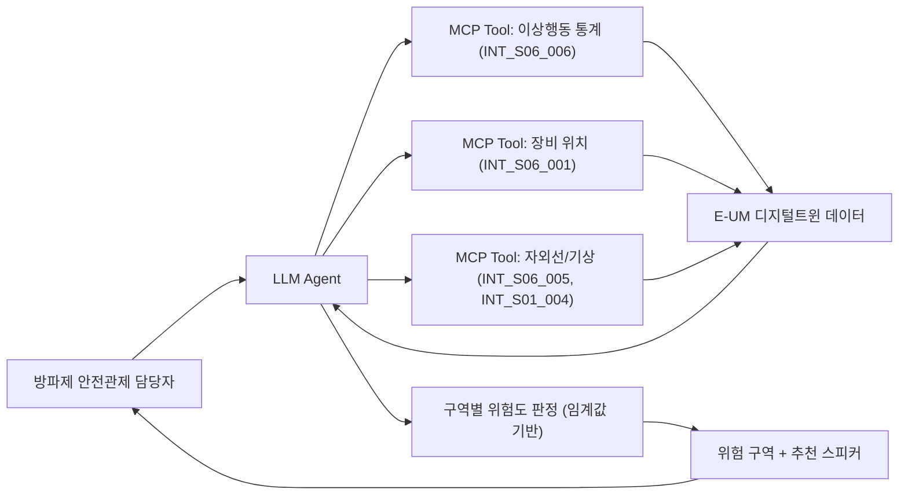

# 구룡포 방파제 보행자 안전 경보 에이전트

- **번호**: 002
- **제안자**: junnnnnw00
- **작성일**: 2026-08-06
- **브랜치**: `idea/002-breakwater-guard`
- **상태**: 초안

## 한 줄 요약

> 구룡포 방파제 안전관제 담당자가 순찰·방송 여부를 판단해야 하는 순간에, AI CCTV 이상행동 통계와 자외선·기상 데이터를 종합해 지금 위험도가 어느 수준인지 판단하고 어느 스피커로 어떤 경보를 내보낼지 추천한다.

## 1. 해결하려는 문제

- 구룡포 방파제(북방파제·남방파제)는 낚시·산책객이 몰리는 관광 명소이면서, 테트라포드 실족·전복 등 인명사고가 반복되는 위험 구역이다. 해양경찰청·포항시가 매년 여름·가을 성수기에 방파제 낚시객 안전사고 예방 캠페인을 벌이는 이유이기도 하다.
- E-UM 디지털트윈은 방파제에 AI CCTV·스피커·자외선 측정기를 이미 설치해 실족감지·침입감지·접근경고·보행자 이상감지 이벤트를 시간대별로 수집하고 있지만(`INT_S06_006`), 이 통계를 담당자가 실시간으로 해석해서 "지금 방송을 내보내야 하는가, 어느 스피커로 내보내야 하는가"까지 판단해주는 장치는 없다 — CCTV 화면과 숫자만 있고 판단은 사람 몫이다.
- 담당 인력은 소수인데 감시 대상 구역(남/북 방파제, 여러 스피커·CCTV 지점)은 여러 곳으로 나뉘어 있어, 이상행동이 몰리는 시간대·구역을 놓치기 쉽다.

## 2. 타깃 이용자

**공무원(포항시 구룡포 방파제 안전관제 담당자)**을 1차 타깃으로 특정한다. (관광객·낚시객은 스피커 방송을 통해 혜택을 받는 간접 수혜자로, MVP 이후 "관광객이 직접 물어보는 안전 챗봇" 형태로 확장 가능)

## 3. 에이전트가 하는 일

> **MVP 범위 안내**: 아래는 최종 지향점이며, MVP(3주 개발 범위)에서는 **북방파제/남방파제 2개 구역 비교 판단 시나리오**만, **보행자안전 API 2개 + 대기환경 API 1개**와 **규칙 기반 위험도 판정**으로 구현한다. 시간대별 추이 예측이나 CCTV 영상 자체 분석은 MVP 이후 범위다 (6번 항목 참고).

**사용자 입력 예시 (MVP 대상)**
```
지금 방파제 상황 어때? 방송 내보내야 돼?
```

**에이전트 내부 동작 (MVP)**
1. `INT_S06_006`(시간대별 이상행동 발생수 통계)를 호출해 남/북 방파제별 실족감지·침입감지·접근경고·보행자 이상감지 건수를 가져온다
2. `INT_S06_005`(자외선 실시간)와 `INT_S01_004`(대기환경 실시간 — 풍속)를 호출해 실족 위험을 높이는 외부 조건(강풍, 강한 자외선으로 인한 부주의)을 함께 본다
3. 구역별로 이상행동 건수 합계에 임계값을 두고 "양호 / 주의 / 위험" 3단계로 판정하고, 위험도가 가장 높은 구역과 그 구역에 설치된 스피커 장비(`INT_S06_001`의 `speakers` 목록)를 매칭해 방송 대상을 추천한다

**출력 예시**
```
북방파제: 최근 1시간 접근경고 12건, 실족감지 2건 — 위험
남방파제: 접근경고 3건 — 양호
현재 풍속 8.1m/s로 강풍주의보 수준, 테트라포드 위 보행 위험이 큽니다.
북방파제 스피커(SR-01-001)로 안전방송을 우선 송출하는 것을 권장합니다.
```

> 단순 질의응답이 아니라 구역별 이상행동 통계 + 기상 조건을 종합해 위험도를 **판단**하고 방송 장비를 **추천**하므로 필수 요건 3(판단·추천·경보·시각화)을 충족한다.

**MVP 이후 지향점 (참고용, 이번 폴더의 구현 대상 아님)**
- 시간대별 이상행동 추이를 학습해 "오후 4시~6시 접근경고 급증 패턴" 같은 사전 경보
- CCTV 영상 자체를 VLM으로 분석해 이상행동 유형(실족 직전 자세 등) 세분화
- 관광객이 직접 "지금 방파제 나가도 돼?"라고 묻는 챗봇 인터페이스로 확장
- 방송 자동 송출(스피커 제어 API 연동) — 현재 카탈로그에는 스피커 제어 API가 없어 조사 필요

## 4. 쓰는 데이터

MVP에서 실제로 호출하는 API는 3개. 상세 호출 기록은 [data.md](data.md)에.

| API ID | 기능 | 이 아이디어에서 쓰는 이유 |
| --- | --- | --- |
| `INT_S06_006` | 시간대별 이상행동 발생수 통계 | 남/북 방파제별 실족감지·침입감지·접근경고·이상감지 건수 — 위험도 판정의 핵심 입력 (MVP 필수) |
| `INT_S06_001` | 보행자 예측 관련 장비 정보 목록 | 구역별로 어느 스피커·CCTV가 설치돼 있는지 위치를 파악해 방송 대상 스피커를 특정 (MVP 필수) |
| `INT_S06_005` | 자외선 측정 장비 실시간 수집 정보 | 강한 자외선 노출 시간대에는 보행자 부주의·장시간 체류가 늘어나는 것을 위험도 가중 요인으로 사용 (MVP 필수) |
| `INT_S01_004` | 대기환경 측정 장비 실시간 수집 정보_단일 | 풍속이 강하면 테트라포드 위 실족 위험이 커지므로 위험도 가중 요인으로 사용 (MVP 선택, 여유 있으면 추가) |

## 5. 차별성

- 해양경찰 안전디딤돌 앱 → 사고 발생 시 신고·위치 전송 기능 위주. 사고 "이후" 대응이지, 사고 전 위험도를 판단해 선제적으로 방송하는 기능이 아님
- CCTV 관제 시스템(현행) → 화면을 사람이 보고 판단. 여러 구역을 동시에 모니터링하는 소수 인력의 판단 부담을 줄여주지 못함
- 기상청 날씨 앱 → 풍속·자외선 수치만 제공. "방파제 실족 위험"이라는 구체적 맥락으로 해석하지 않음
- 이 에이전트는 이상행동 통계(사람의 실제 행동 데이터) + 환경 데이터를 함께 종합하고, 어느 스피커로 방송할지까지 구체적으로 추천한다는 점이 다르다

## 6. 구현 범위

본선 개발 기간은 **2026-09-07 ~ 09-28 (3주)** 뿐이다. MVP는 범위를 최대한 좁혀 "실제로 동작하는 것"을 우선한다.

**꼭 만드는 것 (MVP)**
- [ ] `INT_S06_006`, `INT_S06_001`, `INT_S06_005` 실제 호출하는 MCP 서버 (`prototype/`)
- [ ] 구역별(남/북 방파제) 이상행동 건수 + 자외선/풍속 임계값 기반 "양호/주의/위험" 판단 로직
- [ ] 위험 구역과 매칭되는 스피커 장비를 추천하는 로직
- [ ] 판단 결과를 자연어 문장으로 응답하는 최소 대화 인터페이스 (MCP tool 호출 → LLM 응답)

**되면 좋은 것**
- [ ] `INT_S01_004` 풍속 데이터 추가해 강풍 가중치 반영
- [ ] 시간대별 추이(최근 3시간)를 함께 보여줘 "늘어나는 추세"까지 판단
- [ ] 관광객 대상 챗봇 인터페이스로 확장

**안 만드는 것** — 범위를 미리 잘라두면 심사에서 오히려 유리하다
- CCTV 영상 자체의 실시간 분석 (이미 E-UM이 이상행동 카운트로 1차 가공해 제공하므로 중복 개발)
- 스피커 자동 송출 제어 (제어 API 존재 여부 미확인, 검증 없이 만들면 안전 관련 오작동 리스크)
- 과거 데이터 기반 사고 예측 모델 (선행 연구·실측 검증 없이 만들면 근거 없는 수치가 됨)

## 3. 에이전트가 하는 일

필수 요건 3가지를 여기서 증명한다. 대화 예시를 하나 이상 구체적으로 쓴다.

**사용자 입력 예시**
```
```

**에이전트 내부 동작**
1. (어떤 API를 호출하는가)
2. (무엇을 판단·계산하는가)
3.

**출력 예시**
```
```

> 단순 질의응답이면 요건 미충족이다. **판단·추천·경보·시각화** 중 무엇을 하는지 명확히 적는다.

## 4. 쓰는 데이터

API ID까지 특정한다. 상세는 [data.md](data.md)에.

| API ID | 기능 | 이 아이디어에서 쓰는 이유 |
| --- | --- | --- |
| | | |

## 5. 차별성

기존에 이미 있는 것(포털 날씨, 해양수산부 앱, 안전디딤돌 등) 대비 무엇이 다른가.
"AI를 쓴다"는 차별성이 아니다.

-

## 6. 구현 범위

본선 개발 기간은 **2026-09-07 ~ 09-28 (3주)** 뿐이다.

**꼭 만드는 것 (MVP)**
- [ ]

**되면 좋은 것**
- [ ]

**안 만드는 것** — 범위를 미리 잘라두면 심사에서 오히려 유리하다
-

## 7. 아키텍처



## 8. 기대효과 · 지역 사회 기여

- **포항시 남구청 안전총괄과 / 구룡포읍사무소**: 여름·가을 성수기 방파제 순찰 인력을 위험도가 높은 구역에 우선 배치하는 근거 자료로 활용 가능
- **해양경찰 구룡포파출소**: 반복되는 방파제 실족·전복 사고 예방 캠페인에 "언제·어느 구역이 위험한가"라는 데이터 기반 근거 제공
- 관제 인력이 CCTV 여러 화면을 동시에 주시하지 않아도, 에이전트가 우선순위를 좁혀줘 소수 인력으로도 대응 가능

## 9. 리스크

| 리스크 | 영향 | 대응 |
| --- | --- | --- |
| `INT_S06_006` 이상행동 통계가 시범 설치 초기라 이벤트 수가 적어 임계값 튜닝이 어려울 수 있음 | 위험도 판정이 부정확해질 수 있음 | data.md에 실제 호출 결과로 값 분포를 먼저 확인하고 임계값을 조정 |
| 스피커 제어 API가 카탈로그에 없어 "추천"까지만 가능하고 실제 방송 송출은 사람이 수행해야 함 | MVP가 완결된 자동화로 보이지 않을 수 있음 | 기획서에서 "의사결정 지원" 도구로 명확히 포지셔닝, 자동 송출은 확장 과제로 명시 |
| serviceKey 미발급 상태라 실제 응답 스키마를 카탈로그 문서로만 확인함 | 실제 필드명/값 형식이 문서와 다를 가능성 | 팀 serviceKey 발급 즉시 data.md 재검증 필요 (아래 "확인 필요" 표시) |

## 10. 자체 점수 (심사 기준 그대로)

솔직하게 매긴다. 낮게 나오는 항목이 이 아이디어의 약점이다.

| 항목 | 배점 | 자체 점수 | 근거 |
| --- | --- | --- | --- |
| 구체성 및 논리성 | 30 | 22 | 판단 로직과 대화 예시는 구체적이나, 임계값이 아직 실제 데이터 분포 검증 전이라 근거가 약함 |
| 주제 적합성 | 25 | 22 | 디지털트윈 실시간 데이터를 직접 활용한 안전 경보로 대회 취지에 부합 |
| 실현 가능성 | 25 | 18 | MCP 서버 골격은 동작하나 serviceKey 미발급으로 실제 데이터 검증 전 (키 발급 후 재평가 필요) |
| 지역 사회 기여도 | 20 | 16 | 관제 담당 부서가 명확하고 활용 시나리오가 구체적, 다만 수혜 범위가 관광객 다수보다는 관제 인력 소수에 한정 |
| **합계** | **100** | **78** | serviceKey 발급 후 data.md 실호출 검증하면 실현 가능성 점수 재상향 예상 |
