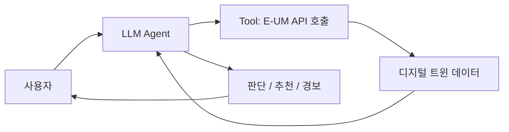

# {{TITLE}}

- **번호**: {{NUM}}
- **제안자**:
- **작성일**: {{DATE}}
- **브랜치**: `{{BRANCH}}`
- **상태**: 초안 / 검토중 / 확정 / 보류 / 폐기

## 한 줄 요약

> 누가 / 어떤 상황에서 / 무엇을 얻는가. 한 문장으로.

## 1. 해결하려는 문제

구룡포에서 **실제로** 일어나는 문제여야 한다. 가능하면 근거를 붙인다 (뉴스, 통계, 현장 사례, 포항시 보도자료).

-

## 2. 타깃 이용자

어민 / 상인 / 관광객 / 주민 / 공무원 중 **하나를 특정**한다. "시민 모두"는 감점 요인이다.

-

## 3. 에이전트가 하는 일

필수 요건 3가지를 여기서 증명한다. 대화 예시를 하나 이상 구체적으로 쓴다.

**사용자 입력 예시**
```
```

**에이전트 내부 동작**
1. (어떤 API를 호출하는가)
2. (무엇을 판단·계산하는가)
3.

**출력 예시**
```
```

> 단순 질의응답이면 요건 미충족이다. **판단·추천·경보·시각화** 중 무엇을 하는지 명확히 적는다.

## 4. 쓰는 데이터

API ID까지 특정한다. 상세는 [data.md](data.md)에.

| API ID | 기능 | 이 아이디어에서 쓰는 이유 |
| --- | --- | --- |
| | | |

## 5. 차별성

기존에 이미 있는 것(포털 날씨, 해양수산부 앱, 안전디딤돌 등) 대비 무엇이 다른가.
"AI를 쓴다"는 차별성이 아니다.

-

## 6. 구현 범위

본선 개발 기간은 **2026-09-07 ~ 09-28 (3주)** 뿐이다.

**꼭 만드는 것 (MVP)**
- [ ]

**되면 좋은 것**
- [ ]

**안 만드는 것** — 범위를 미리 잘라두면 심사에서 오히려 유리하다
-

## 7. 아키텍처



## 8. 기대효과 · 지역 사회 기여

포항시가 이 서비스를 **어느 부서에서 어떻게 쓸 수 있는지**까지 쓰면 배점 20점을 확보하기 쉽다.

-

## 9. 리스크

| 리스크 | 영향 | 대응 |
| --- | --- | --- |
| | | |

## 10. 자체 점수 (심사 기준 그대로)

솔직하게 매긴다. 낮게 나오는 항목이 이 아이디어의 약점이다.

| 항목 | 배점 | 자체 점수 | 근거 |
| --- | --- | --- | --- |
| 구체성 및 논리성 | 30 | | |
| 주제 적합성 | 25 | | |
| 실현 가능성 | 25 | | |
| 지역 사회 기여도 | 20 | | |
| **합계** | **100** | | |
